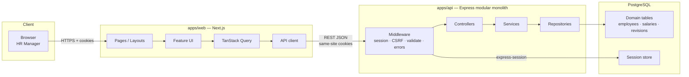

# ACME Compensation Hub: Architecture

**Status:** Design · **Baseline:** `docs/REQUIREMENTS.md`  
**Legend:** **[C]** confirmed · **[A]** assumption · **[U]** unresolved

Modular monolith for ACME salary management (~10,000 employees, multiple countries). Separate Next.js and Express apps, one PostgreSQL database. No Prisma schemas, OpenAPI, or application code in this document.

**Stack [C]:** Next.js, React, TypeScript, Tailwind, shadcn/ui, TanStack Query, Recharts · Express, Zod, REST · PostgreSQL, Prisma · express-session (PG store), HttpOnly cookies, Secure in production, CSRF, Argon2id · Vitest, Supertest, React Testing Library.

No microservices or Redis initially **[C]**.

---

## 1. System overview

| Component | Role |
|-----------|------|
| **Web (Next.js)** | HR Manager UI: employees, salaries, analytics |
| **API (Express)** | Auth, domain logic, persistence |
| **PostgreSQL** | Employees, salaries, revisions, sessions, reference data |

| Layer | Responsibility |
|-------|----------------|
| Pages / layouts | Auth shell, navigation |
| Feature UI | Employee, salary, analytics screens |
| API client + TanStack Query | Cookie credentials; server-state cache |
| Middleware | Session, CSRF, validation, errors |
| Controllers → services → repositories | HTTP mapping · business rules · Prisma access |
| Seed script | ~10,000 employees **[C]** |

Out of scope (see requirements): payroll, self-service, benefits/equity/merit, HRIS/SSO, native mobile, heavy BI.

---

## 2. High-level architecture



**Boundaries [C]:** Browser ↔ Next.js (UI); Browser ↔ Express (REST + session cookie under same-site reverse proxy preferred; cookie `Domain`/`SameSite` **[U]**); Express ↔ PostgreSQL (Prisma + session store). Next.js does not write domain data directly.

---

## 3. Application structure

Monorepo with `pnpm` workspaces **[A]**. Turborepo/Nx not required initially.

```text
acme-compensation-hub/
├── apps/
│   ├── web/                 # Next.js + React + Tailwind + shadcn/ui
│   └── api/                 # Express + Zod + Prisma
├── packages/
│   └── shared/              # Optional shared Zod/DTO types
├── docs/
├── .gitignore
└── README.md
```

**`apps/api` [A]:** `middleware/` · `modules/{auth,employees,salaries,analytics}/` (`*.routes`, `*.controller`, `*.service`, `*.repository`, `*.schemas`) · `db/` · `lib/` · `prisma/` (schema + seed). Cross-module calls: service → service.

**`apps/web` [A]:** App Router · `components/ui` (shadcn) · `features/{auth,employees,salaries,analytics}` · `lib/api-client`, `query-client`.

Avoid deep generic domain packages, premature CQRS, or a BFF unless same-site deploy fails **[U]**.

---

## 4. Backend

- **Routing [C]:** versioned prefix e.g. `/api/v1` **[A]**; modules `auth`, `employees`, `salaries`, `analytics`.
- **Middleware order:** security headers / request ID **[A]** → JSON → session (PG) **[C]** → CSRF (synchronizer token + Origin) **[C]** → auth gate → Zod → controller.
- **Controllers:** HTTP ↔ services only; map domain errors to status codes.
- **Services:** revision history rules, Option A currency rules, pagination, transactions, concurrency (OCC; see `docs/DATABASE_SCHEMA.md`) **[C]**.
- **Repositories:** Prisma only; prevent N+1 via planned includes/selects.
- **Validation [C]:** Zod at the HTTP boundary; services re-check invariants (e.g. reject mixed-currency sums).
- **Errors [A]:** typed domain errors; central JSON error middleware; no stacks to clients in production.

---

## 5. Frontend

- Authenticated shell: Employees, salary detail/history, Analytics; login outside shell **[A]**.
- Feature folders; shadcn primitives only in `components/ui` **[C]**.
- API client: `credentials: 'include'`; CSRF token on mutating requests **[C]** (wire format **[U]**).
- TanStack Query for lists/detail/analytics; invalidate on mutations **[C]**.
- Forms: React Hook Form + Zod + `@hookform/resolvers` **[C]** (one schema language with the API).
- Recharts: per-currency series only; no client cross-currency totals **[C]**.

---

## 6. Authentication and authorization

SSO is out of scope **[C]**.

| Concern | Choice **[C]** |
|---------|----------------|
| Session | `express-session` + PostgreSQL store |
| Cookie | HttpOnly; `Secure` in production; `SameSite`/`Domain` **[U]** |
| Passwords | Argon2id |
| CSRF | Synchronizer token + Origin / Referer checks |

**Login:** email + password **[A]** (email chosen in database design) → verify Argon2id → regenerate session, store `userId`, set cookie. Failures stay generic.

**Session:** PG-backed; protected routes require `userId`. Idle/absolute TTL **[U]** (illustrative 8h absolute **[A]**). Logout destroys session and clears cookie. Password-change / multi-session revoke **[U]**.

**Authorization:** authenticated HR Manager can perform all in-scope operations; no RBAC **[C]**. Seed ≥1 HR user; account count **[U]**.

---

## 7. Data flow

**Employee list/detail:** paginated/filtered query → indexed repository → page + metadata; detail by id or 404.

**Employee write:** CSRF + session → validate → insert/update (transaction if multi-table) → invalidate queries.

**Salary revision [C]:** submit new amount, currency, effective date + expected version → one transaction: concurrency check, update current salary, insert revision (previous/new amount and currency, effective date, change timestamp, actor). Conflicts → HTTP 409 **[A]**; UI reloads and retries. Details in `docs/DATABASE_SCHEMA.md`.

**Analytics:** filters + Option A currency rules → SQL aggregates → Recharts. No cross-currency grand totals; no FX in v1.

---

## 8. Multi-country and currency (Option A) **[C]**

- Amounts always carry ISO 4217 currency **[A]**; employee has country for filters **[C]**.
- Analytics: group by currency and/or filter to one currency.
- No automatic FX; no cross-currency totals; reporting currency deferred **[U]** beyond v1.
- Service rejects mixed-currency sums; UI must not sum mixed series.

---

## 9. Performance (~10k)

| Concern | Approach |
|---------|----------|
| Lists | Server-side pagination + push-down filters **[C]** |
| Indexes | FKs, country, common filters, session expiry **[A]** (exact list in schema doc) |
| Aggregations | In-DB `GROUP BY` / `SUM` / `COUNT` **[C]** |
| N+1 | Planned Prisma selects; hot-path tests **[A]** |
| Seed | Batched bulk insert **[A]** |
| Sessions | Indexed PG store + TTL/cleanup **[A]** |

No cache tier initially **[C]**.

---

## 10. Security and integrity

| Topic | Approach **[C]** unless noted |
|-------|-------------------------------|
| Confidentiality | HTTPS in production; session on all domain APIs |
| Validation | Zod + DB constraints **[A]** |
| Transactions | Salary update + revision insert atomic |
| Concurrency | Optimistic `version` on current salary (schema doc) |
| Access | HR session only; no SSO |
| Secrets | Env only (`SESSION_SECRET`, `DATABASE_URL`, …) |

---

## 11. Deployment

**Preferred topology [C]:** same-site reverse proxy.

```text
[Browser] → [Reverse proxy]
              ├─ /     → Next.js
              └─ /api  → Express → PostgreSQL
```

Hosting provider **[U]**. Deployed app + demo required by assessment **[C]**.

| Env (illustrative) **[A]** | Used by |
|----------------------------|---------|
| `DATABASE_URL` | API, Prisma, sessions |
| `SESSION_SECRET` | API |
| `NODE_ENV` | Secure cookies, error detail |
| `CORS_ORIGIN` / `WEB_ORIGIN` | Only if cross-origin |
| `NEXT_PUBLIC_API_BASE_URL` | Web (relative if proxied) |

Managed PostgreSQL in production; local/Docker for dev **[A]**. Migrate before/with API deploy; health check **[A]**; backup ownership **[U]**; seed for demo **[A]**.

---

## 12. Unresolved decisions

| Item | Phase |
|------|-------|
| Session idle/absolute TTL | Security |
| CSRF header/library/rotation/failure responses | Security |
| Cookie `SameSite` / `Domain` | Security + deployment |
| Password-change UI / invalidate other sessions | Security |
| HR seed count beyond ≥1 | Auth / seed |
| Hosting provider; backup/restore owner | Deployment |
| BFF only if same-site topology fails | Contingency |
| Reporting currency / FX | Deferred beyond v1 |

Database design resolutions (OCC, email login, no notes/role column, etc.) live in `docs/DATABASE_SCHEMA.md`.
